# Image Noise, Filtering, Edge Detection and Histograms
This project is an image-processing toolkit implemented largely from scratch with NumPy. It covers noise generation, spatial and frequency-domain filtering, hybrid images, manual 2D convolution, edge detection, intensity normalization, grayscale conversion, and histogram analysis and equalization. Results are demonstrated through a web interface; screenshots are in the `Screenshots/` folder.

---

## Table of Contents

1. [Noise Addition](#1-noise-addition)
2. [Low-Pass Filtering (Spatial Domain)](#2-low-pass-filtering-spatial-domain)
3. [Frequency Filtering](#3-frequency-filtering)
4. [Hybrid Images](#4-hybrid-images)
5. [2D Convolution (Manual Implementation)](#5-2d-convolution-manual-implementation)
6. [Edge Detection](#6-edge-detection)
7. [Image Normalization](#7-image-normalization)
8. [RGB to Grayscale Conversion](#8-rgb-to-grayscale-conversion)
9. [Histogram, CDF and Equalization](#9-histogram-computation-and-visualization)

---

## 1. Noise Addition

Noise models the random corruption real images pick up from sensors, transmission, and low light. Adding controlled noise lets us test how well different filters recover the original image. All three noise types are implemented in one function:

```python
add_noise(img, noise_type, ...)
```

### Additive noise pipeline (Gaussian and Uniform)

These noises are additive: `noisy = original + noise`.

1. **Convert to float.** The image is cast from `uint8` to `float32`. In `uint8`, values wrap around outside 0–255 (e.g. `250 + 10` wraps to `4`), which would corrupt the result.
2. **Generate noise.** A noise array of the same shape as the image is drawn, so every pixel and channel gets an independent random value.
3. **Add and clip.** The noise is added and the result is clipped to `[0, 255]` with `np.clip`, so out-of-range values saturate at black or white.
4. **Convert back** to `uint8`.

### Gaussian noise
Values are drawn from a normal distribution with mean `mean` (default 0) and standard deviation `sigma` (default 25). With mean 0 the noise is equally likely to brighten or darken a pixel, and most values stay within about ±2σ. Larger `sigma` gives a grainier image.

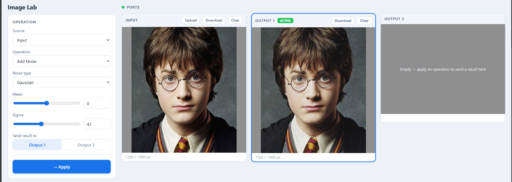

### Uniform noise
Values are drawn uniformly from `[low, high]` (defaults −50 and 50). The interval's width controls the strength. If it is symmetric around 0 the noise has zero mean and adds grain without changing overall brightness. Otherwise the midpoint acts as a constant brightness offset (e.g. `low=0, high=50` brightens by about 25 levels on average).

### Salt-and-pepper noise
A fraction `p` of pixels is replaced outright with pure black (pepper, 0) or pure white (salt, 255). The original value is lost, so this noise is **not additive** and works directly on the `uint8` image.

**Method**
1. Generate one uniform random number in `[0, 1)` per pixel position (shape `H × W`, not per channel).
2. Define `pepper_threshold = p/2` and `salt_threshold = 1 − p/2`.
3. Pixels below the pepper threshold become 0; pixels above the salt threshold become 255; the rest are unchanged.

The two intervals sit at opposite ends of the range so they never overlap (for any `p < 1`), each is chosen with probability `p/2`, and the total corrupted fraction is `p`. With the default `p = 0.05`, about 2.5% of pixels turn black, 2.5% turn white, and 95% are untouched.

Because the decision is made **per pixel**, a noisy colour pixel becomes `(0,0,0)` or `(255,255,255)` as a whole, rather than corrupting channels independently.

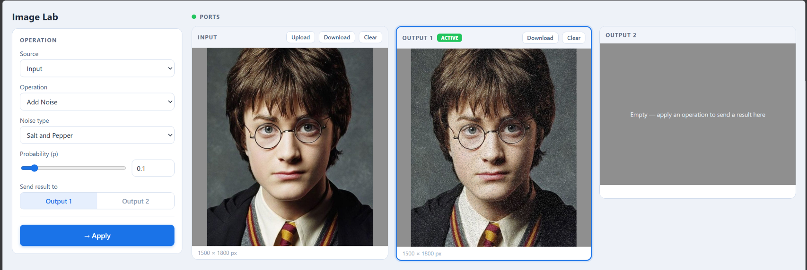

### Summary

| Noise type | Mechanism | Parameters | Effect on pixel |
|---|---|---|---|
| Gaussian | Additive, normal distribution | `mean`, `sigma` | Small shift, usually near zero |
| Uniform | Additive, uniform distribution | `low`, `high` | Bounded shift in `[low, high]` |
| Salt and pepper | Replacement | `p` | Pixel set to 0 or 255 |

---

## 2. Low-Pass Filtering (Spatial Domain)

A low-pass filter keeps smooth, slowly varying content and suppresses rapid changes such as noise and fine edges, producing a blurred image. Three filters are implemented in one function:

```python
low_pass_filter(img, filter_type, kernel_size, sigma, manual)
```

`kernel_size` is the width of the square window and should be odd so the window has a well-defined centre pixel.

### Average filter
Each output pixel is the mean of its `k × k` neighbourhood, implemented as a convolution with a kernel whose weights all equal `1/k²` (for 3×3, each is `1/9`). It reduces Gaussian and uniform noise well but weights all neighbours equally, so it blurs edges noticeably.

### Gaussian filter
The weights fall off smoothly with distance from the centre, so closer pixels count more.

**Kernel construction**
1. Build offsets from the centre: for `half = k // 2`, offsets run from `−half` to `+half`.
2. Use `np.meshgrid` to build grids `x` and `y` of each cell's offset.
3. Compute weights `exp(−(x² + y²) / (2σ²))`. Small σ gives a narrow kernel and light blur; large σ gives a wide kernel and strong blur.
4. Normalise by the **sum** of the weights so they add up to 1, which preserves overall brightness. The `1/(2πσ²)` constant is not used because it only yields a total of 1 for an infinite kernel, while ours is truncated.

Compared with the average filter, it gives a more natural blur and preserves edges somewhat better at the same kernel size.

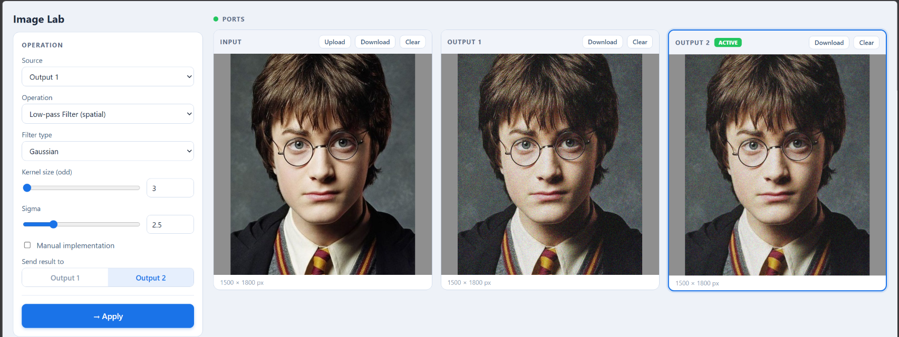

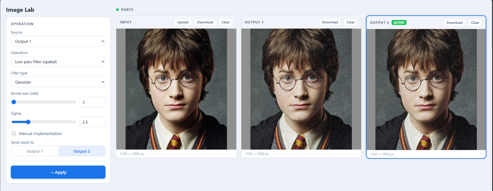

As the second screenshot shows, the Gaussian (and average) filter handles Gaussian noise well but only smears salt-and-pepper impulses into their neighbours instead of removing them.

### Median filter
Each pixel is replaced with the median of its `k × k` neighbourhood. It is **non-linear**, so it cannot be written as a convolution.

- **Border handling:** the image is padded by `pad = k // 2` on each side using reflective padding (`mode='reflect'`), which mirrors the content and avoids the dark edges zero padding would create. The pad list holds one `(before, after)` pair per axis, with `(0, 0)` for the channel axis on colour images, so the same line handles grayscale and colour.
- **Filtering:** for each pixel `(i, j)`, the window `padded[i:i+k, j:j+k]` is extracted (exactly the window centred on the original pixel). For colour images the median is computed separately per channel.
- **Properties:** an extreme outlier can never be the median of its neighbourhood, so impulse values are discarded rather than averaged into neighbours. **This makes the median filter the best choice for salt-and-pepper noise**, and it preserves edges better than linear filters. The drawback is speed: the implementation uses a double Python loop over all pixels, which is slow on large images.

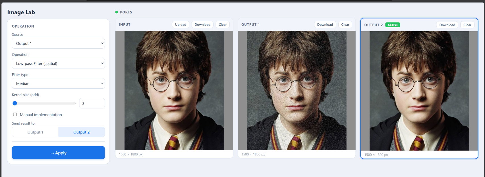

### Which filter suits which noise

| Filter | Type | Best against | Weakness |
|---|---|---|---|
| Average | Linear | Gaussian, uniform | Blurs edges, smears impulses |
| Gaussian | Linear | Gaussian, uniform | Still blurs edges, weak on impulses |
| **Median** | Non-linear | **Salt and pepper** | Slow, can remove fine detail |

---

## 3. Frequency Filtering

Frequency filtering transforms the image into the frequency domain to manipulate specific frequency components.

**2D spectrum.** A 2D FFT is applied to the image, followed by `fftshift` to centre the zero-frequency (DC) component. In the shifted spectrum, the centre holds low frequencies (gradual variations, overall structure, background) and the outer region holds high frequencies (fine details, edges, corners).

**Filter kernel.** A Gaussian mask is used because it avoids the ringing artifacts of ideal sharp-cutoff filters, has no negative values, and resembles physical diffusion. The 2D Gaussian is

```
G(x, y) = exp( −((x − cx)² + (y − cy)²) / (2σ²) )
```

**Low-pass vs. high-pass**

- **Low-pass:** keeps the central region of the spectrum and attenuates high frequencies, giving a smoothed image.
- **High-pass:** uses the inverted mask `1 − G`, attenuating the centre and preserving the outer region to isolate edges and fine detail.

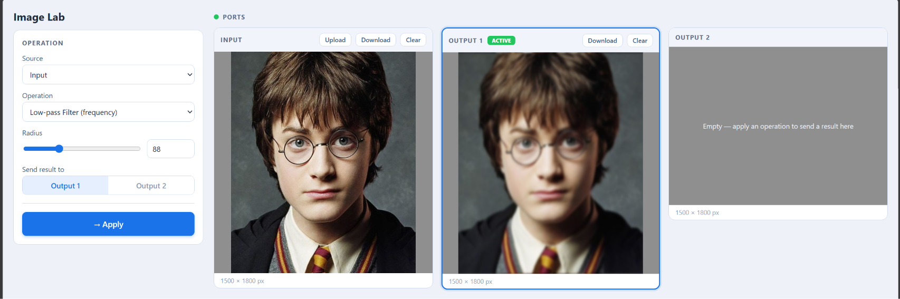

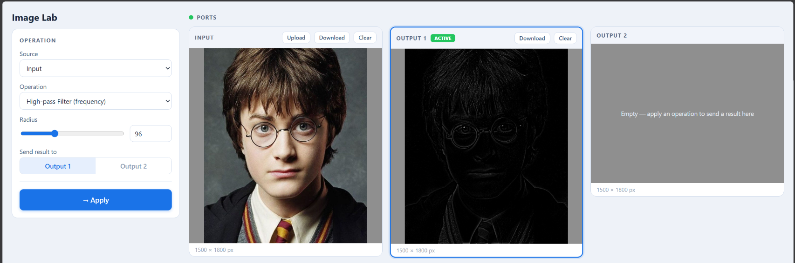

The Sobel-based high-pass result is also shown for comparison:

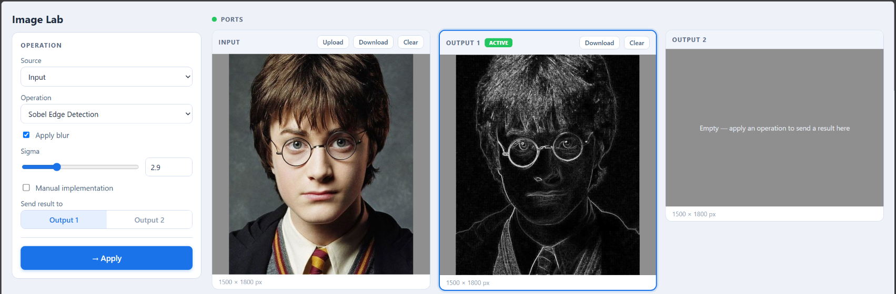

---

## 4. Hybrid Images

A hybrid image combines the low frequencies of one image with the high frequencies of another, so the perceived content changes with viewing distance. Up close the fine details of the second image dominate; from far away only the smooth structure of the first remains.

**Formulation.** For input images `I1`, `I2` and Gaussian masks `G1`, `G2`:

```
H = I1·G1 + I2·(1 − G2)
```

- `I1·G1` keeps the low-frequency content of the first image (visible from a distance).
- `I2·(1 − G2)` keeps the high-frequency content of the second (visible up close).

**Pipeline**
1. **Preprocessing & alignment:** make both images the same size (resize with interpolation if needed) and convert to grayscale or matching channels.
2. **Filtering:** apply a Gaussian low-pass to the first image and a high-pass (`1 − Gaussian`) to the second.
3. **Blending:** combine with balancing coefficients, then clip and normalise to `[0, 255]`.

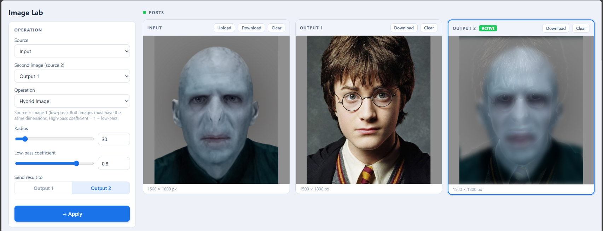

---

## 5. 2D Convolution (Manual Implementation)

Convolution is the core of spatial filtering and edge detection. It is implemented manually in `_convolve_channel_manual` and wrapped by `ConvolveImage`, which processes a grayscale image directly or each RGB channel independently. A `manual` flag switches between the loop-based implementation and `scipy.signal.correlate2d`, which is used to verify that the manual version gives identical results.

The operation is technically **cross-correlation** (the kernel is not flipped):

```
O(i, j) = Σm Σn  P(i + m, j + n) · K(m, n)
```

where `P` is the zero-padded channel and `K` is the `kh × kw` kernel. For symmetric kernels (Gaussian, average) and gradient kernels (where flipping only changes the sign, which disappears in the magnitude), this equals true convolution.

**Padding ("same" output size)**

```
pad_top  = ⌊(kh − 1) / 2⌋      pad_bottom = kh − 1 − pad_top
pad_left = ⌊(kw − 1) / 2⌋      pad_right  = kw − 1 − pad_left
```

This also supports even-sized kernels such as the 2×2 Roberts kernels (extra padding goes to the bottom and right).

**Algorithm**
1. Zero-pad the channel.
2. For every pixel `(i, j)`, extract the kernel-sized region of the padded image starting at `(i, j)`.
3. Multiply element-wise by the kernel and sum.
4. Store the sum at `(i, j)`; the output stays `float64` to avoid overflow or truncation.

### Performance: manual vs. SciPy

`scipy.signal.correlate2d` is **much faster** than the manual implementation. The manual version iterates over every pixel in Python loops, paying interpreter overhead per pixel, whereas SciPy runs the computation in optimised, compiled, vectorised code. The manual implementation is kept for demonstration and verification, while the `manual` flag lets you compare the two.

---

## 6. Edge Detection

Edge detection highlights locations where intensity changes sharply. Sobel, Prewitt and Roberts are implemented from scratch on top of our convolution function; Canny uses OpenCV's `cv2.Canny`.

### Gradient-based operators
Each operator uses two kernels estimating the gradient in two directions:

```
Gx = I ∗ Kx        Gy = I ∗ Ky
G(i, j) = √( Gx² + Gy² )
E(i, j) = min( max( G(i, j), 0 ), 255 )     → uint8
θ(i, j) = arctan( Gy / Gx )
```

**Sobel (3×3)**: the centre row/column is weighted by 2, adding smoothing perpendicular to the gradient and reducing noise sensitivity.

```
Kx = [ -1  0  1 ]      Ky = [ -1 -2 -1 ]
     [ -2  0  2 ]           [  0  0  0 ]
     [ -1  0  1 ]           [  1  2  1 ]
```

**Prewitt (3×3)**: like Sobel but with uniform weights, so it smooths less.

```
Kx = [ -1  0  1 ]      Ky = [ -1 -1 -1 ]
     [ -1  0  1 ]           [  0  0  0 ]
     [ -1  0  1 ]           [  1  1  1 ]
```

**Roberts (2×2)**: gradients along the two diagonals; the smallest and fastest operators but the most noise-sensitive.

```
Kx = [ 1  0 ]          Ky = [  0  1 ]
     [ 0 -1 ]               [ -1  0 ]
```

### Optional Gaussian pre-smoothing
Because derivative operators amplify noise, an optional `apply_blur` parameter first smooths the image with a 3×3 Gaussian low-pass filter (standard deviation σ, kernel normalised to sum to 1).

### Canny edge detector
Canny is a multi-stage detector performed by `cv2.Canny`:
1. Gaussian smoothing to reduce noise.
2. Gradient magnitude and direction computation.
3. Non-maximum suppression, thinning edges to one pixel.
4. Double thresholding: above `T_high` is a strong edge, between `T_low` and `T_high` is a weak candidate, below `T_low` is discarded.
5. Hysteresis: weak edges are kept only if connected to a strong edge.

Three threshold modes are supported:
- **Manual:** user-specified `T_low`, `T_high` (defaults 100 and 200).
- **Image percentile:** `T_low = P25(I)`, `T_high = P75(I)` over pixel intensities.
- **Gradient percentile:** `T_low = P25(E)`, `T_high = P75(E)` over the Sobel gradient magnitude, so thresholds adapt to the image's actual edge strengths.

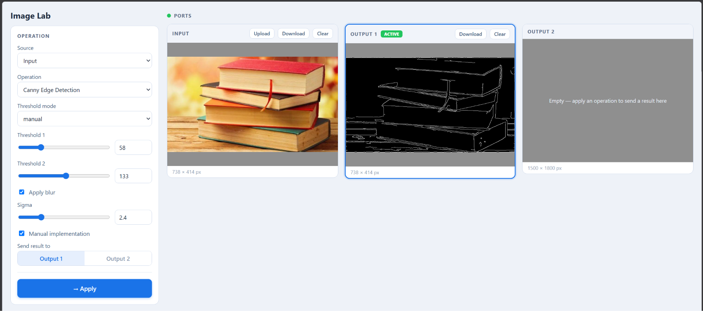

### Observations
Sobel produced thicker, smoother edges and was more robust to noise than Prewitt. Roberts was the most noise-sensitive and produced thinner but more fragmented edges. Canny gave the cleanest, thinnest and most connected edges thanks to non-maximum suppression and hysteresis.

---

## 7. Image Normalization

Min-max normalization linearly stretches intensities so the darkest pixel maps to 0 and the brightest to 255. It improves contrast for images that occupy a narrow intensity range and brings outputs of operations like convolution (which can leave the 0–255 range) back to a displayable range. This is intensity scaling, not binarization.

```
I_norm(i, j) = 255 · ( I(i, j) − I_min ) / ( I_max − I_min )
```

The result is converted to `uint8`.

**Edge case:** if `I_max = I_min` (a single-colour image) the denominator is zero, so the image is returned unchanged since there is no contrast to stretch.

---

## 8. RGB to Grayscale Conversion

`TransformIntoGrayScale` supports two modes. The image is first cast to `float32` to avoid overflow when summing channels, and the result is cast back to `uint8`. Any other mode raises a `ValueError`.

**Weighted (luminosity) method:** accounts for human perception, which is most sensitive to green and least to blue, using the ITU-R BT.601 luma weights:

```
Gray = 0.2989·R + 0.5870·G + 0.1140·B
```

**Average method:** gives equal importance to all channels:

```
Gray = (R + G + B) / 3
```

The weighted method preserves perceived brightness better. For example, saturated green and blue regions that look very different to the eye appear with similar intensities under the average method.

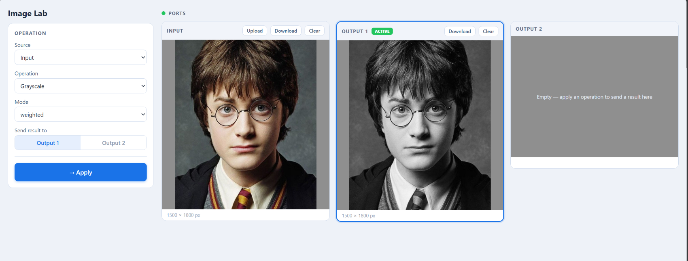

---

## 9. Histogram Computation and Visualization

The `Histogram` class computes an image's intensity distribution entirely from scratch, without `np.histogram` or `plt.hist`. It detects the image type from its shape: if the last dimension is 3 the image is treated as RGB and each channel is processed separately; otherwise it is single-channel grayscale. Grayscale gives one histogram of shape `(256,)`; RGB gives an array of shape `(3, 256)`.

### Frequency (histogram)
For an 8-bit image there are `L = 256` levels:

```
h(r_k) = n_k,    k = 0, 1, …, L − 1
Σ n_k = N = H × W
```

Each channel is flattened and occurrences counted with Python's `Counter`. Levels that do not appear get a count of 0, so the output always has exactly 256 entries.

### Probability distribution (PDF)
To compare images of different sizes, counts are normalised:

```
p(r_k) = n_k / N,     Σ p(r_k) = 1
```

### Cumulative distribution function (CDF)

```
C(r_k) = Σ_{j=0..k} p(r_j)
C(r_0) = p(r_0),   C(r_k) = C(r_{k−1}) + p(r_k)
0 ≤ C(r_0) ≤ … ≤ C(r_{L−1}) = 1
```

The CDF is plotted as a line (the histogram and PDF are bars) since it is a cumulative curve. For RGB images it is calculated and plotted per channel in three stacked subplots. A steep section means many pixels fall in that range; a flat section means few or none do.

### Plotting
A single `_plot` routine handles the histogram, PDF, CDF and equalized histogram, with a `kind` parameter selecting bars or a line. Grayscale gets one plot; RGB gets three vertically stacked subplots sharing the x-axis, coloured red, green and blue. Figures are rendered to an in-memory PNG buffer (Matplotlib `Agg` backend) and returned as bytes so a server can send them directly, and every figure is closed after saving to prevent memory leaks.

A dark image has its histogram concentrated on the left, a bright image on the right, and a low-contrast image in a narrow band. A good-contrast image has a CDF that rises roughly linearly over the whole range.

### Histogram equalization

**Mapping function.** For every original level `r_k`:

```
s_k = round( (L − 1) · C(r_k) ),    L = 256
```

`equalized_level` returns a lookup table of 256 new levels (or three tables for RGB). Since the CDF is monotonic, the mapping preserves the order of intensities.

**Applying the mapping.** In `equalize_image`, the table is applied by indexing, `I_eq(i, j) = s[I(i, j)]`, with a separate table per channel for RGB. A lookup table means each pixel needs only a single array access.

**Equalized histogram.** `equalize_histogram` transfers the original counts to their new levels, adding counts when several levels merge:

```
h_eq(s) = Σ n_k   over all k with s_k = s
```

This is why the equalized histogram of a discrete image is not perfectly flat: it has gaps at levels no `s_k` maps to and taller bars where levels merged.

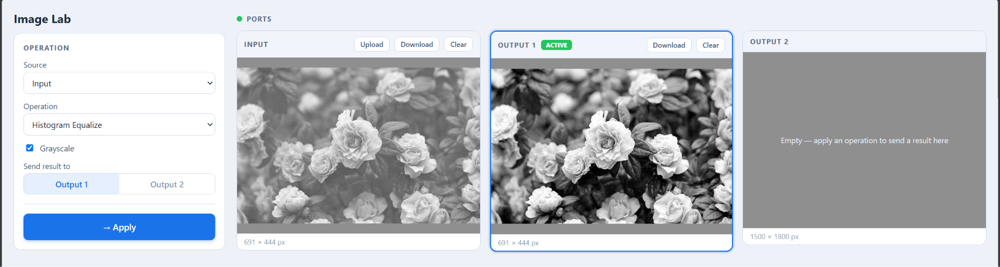

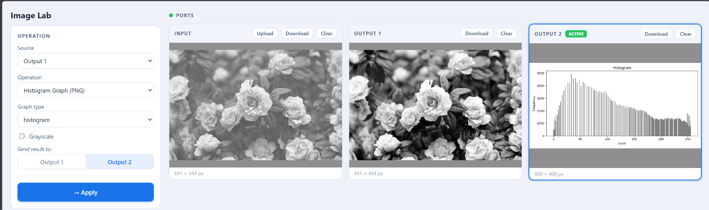

After equalization, more detail is visible in dark and bright regions and the histogram spreads over the full range.
