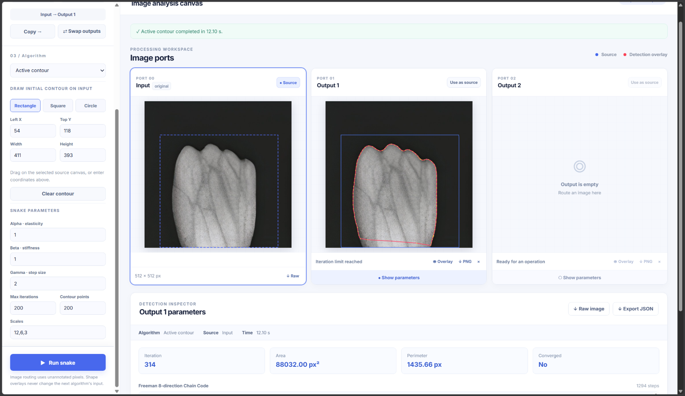
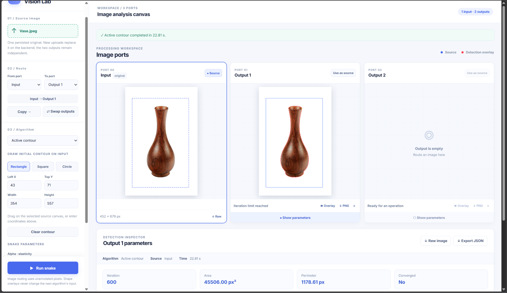
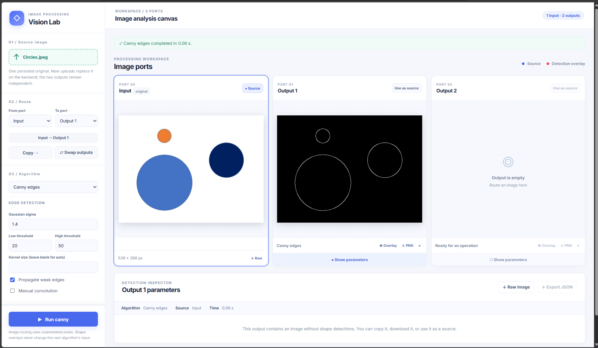
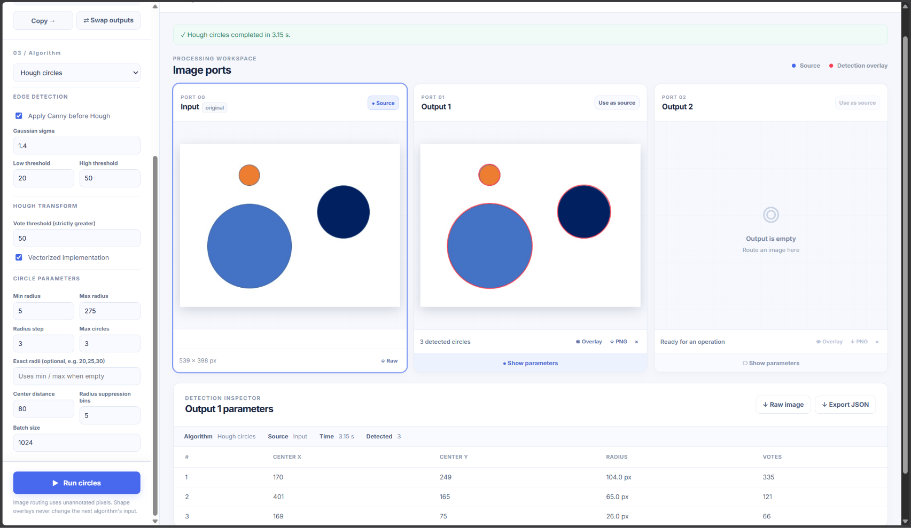

# Image Processing & Shape Detection

An interactive computer vision application for experimenting with **edge detection, geometric shape detection, and contour-based image segmentation**. The project combines an **Angular frontend** for uploading images, adjusting algorithm parameters, and inspecting results with a **Python FastAPI backend** that performs the image-processing operations.

The application covers Canny edge detection, Hough transforms for lines, circles, and ellipses, greedy active contours (snakes), and Freeman 8-direction chain codes.

## Features

| Feature | What it does |
| --- | --- |
| **Canny Edge Detection** | Produces an edge map with configurable Gaussian smoothing, low/high thresholds, and edge propagation. |
| **Hough Line Transform** | Finds straight lines and reports their polar coordinates (`rho`, `theta`); can draw detected lines over the source image. |
| **Hough Circle Transform** | Detects circles across a configurable radius range and reports center coordinates, radius, and vote count. |
| **Hough Ellipse Transform** | Detects ellipses and reports their center, semi-axes, rotation, and supporting votes. |
| **Active Contour (Snake)** | Refines a user-defined initial contour toward object boundaries with a multi-scale greedy snake algorithm. |
| **Freeman Chain Code** | Encodes contour boundaries as 8-direction steps; active-contour iteration output also includes final area and perimeter. |
| **Image Reuse** | Saves the most recently uploaded image as a lossless PNG so different algorithms can run without re-uploading it. |

## Screenshots

The screenshots show the interface and example image-processing results for the different algorithms.

| Active Contour - Example 1 | Active Contour - Example 2 |
| :---: | :---: |
|  |  |

| Canny Edge Detection | Hough Line Detection |
| :---: | :---: |
|  |  |

| Hough Circle Detection | Hough Ellipse Detection |
| :---: | :---: |
|  |  |

> **Screenshot setup:** Create a `screenshots/` directory at the repository root and copy the six original PNG screenshots into it. The paths above preserve the filenames shown in the supplied folder screenshot, including `ActiveCountour` and the spaces in the Hough filenames. If you store the screenshots elsewhere, update these relative paths.

## Technology Stack

| Layer | Technology | Purpose |
| --- | --- | --- |
| Frontend | Angular, TypeScript | Image upload, algorithm configuration, and result visualization |
| Backend | Python, FastAPI | HTTP endpoints, validation, image processing, and streamed responses |
| Image processing | OpenCV, NumPy | Image decoding, grayscale conversion, numerical operations, and PNG encoding |
| Optional acceleration | Numba | Faster Hough ellipse detection on suitable inputs |

## How It Works

1. **Upload an image** using the interface or `POST /images/upload`. The backend validates the file and retains the latest image as a PNG.
2. **Select an algorithm** and configure its parameters. Canny produces an edge map; Hough algorithms can optionally run Canny before shape detection.
3. **Run the operation.** The API returns a PNG image, a JSON representation of detected shapes/contours, or a stream of contour iterations, depending on the endpoint.
4. **Inspect the result** in the frontend, or consume the returned data programmatically.

For Hough transforms, the backend can overlay detected shapes on the original image. For active contours, the overlay endpoint draws the **initial contour in blue** and the **final contour in red**.

## API Reference

All processing routes use **POST** and accept form fields. Most image-processing routes accept an optional multipart `file`; when it is omitted, the API uses the previously saved image.

### Image Management

| Method | Endpoint | Response | Description |
| --- | --- | --- | --- |
| `GET` | `/` | JSON | Simple API-running status message |
| `POST` | `/images/upload` | JSON | Save an uploaded image and return width, height, and channel count |
| `GET` | `/images/latest` | PNG | Retrieve the latest saved image |

### Edge and Shape Detection

| Method | Endpoint | Response | Description |
| --- | --- | --- | --- |
| `POST` | `/canny` | PNG | Canny edge map |
| `POST` | `/hough-lines` | JSON | Detected line coordinates and accumulator shape |
| `POST` | `/hough-lines/overlay` | PNG | Detected lines drawn on the image |
| `POST` | `/hough-circles` | JSON | Detected circle centers, radii, votes, and accumulator shape |
| `POST` | `/hough-circles/overlay` | PNG | Detected circles drawn on the image |
| `POST` | `/hough-ellipses` | JSON | Detected ellipse geometry, votes, and number of edge points |
| `POST` | `/hough-ellipses/overlay` | PNG | Detected ellipses drawn on the image |

### Active Contours and Chain Codes

| Method | Endpoint | Response | Description |
| --- | --- | --- | --- |
| `POST` | `/active-contour/edge-map` | PNG | Edge map used to attract the snake |
| `POST` | `/active-contour` | JSON | Initial and final contour coordinates |
| `POST` | `/active-contour/iterations` | NDJSON stream | Contour, chain code, and convergence details for each iteration; final area and perimeter |
| `POST` | `/active-contour/overlay` | PNG | Image with the initial and final contours |
| `POST` | `/chain-code` | JSON | Freeman 8-direction chain code and starting pixel for supplied contour points |

### Important Parameters

**Canny (`/canny`)**

| Form field | Default | Description |
| --- | --- | --- |
| `sigma` | `1.4` | Gaussian smoothing strength |
| `low_threshold` | `20` | Lower hysteresis threshold |
| `high_threshold` | `50` | Upper hysteresis threshold |
| `kernel_size` | Derived from `sigma` | Optional odd Gaussian kernel size, from 3 to 51 |
| `propagate` | `true` | Extend weak edges through connected chains |
| `manual` | `false` | Use the manual convolution implementation |

**Hough transforms (shared preprocessing)**

| Form field | Default | Description |
| --- | --- | --- |
| `apply_canny` | `true` | Run Canny before Hough detection; set to `false` for an existing edge map |
| `sigma` | `1.4` | Canny Gaussian smoothing strength |
| `low_threshold` | `20` | Canny lower threshold |
| `high_threshold` | `50` | Canny upper threshold |

Additional detection options:

| Algorithm | Key options | Default values |
| --- | --- | --- |
| Lines | `threshold`, `use_vectorized`, `use_nms`, `rho_distance`, `theta_distance` | `100`, `true`, `true`, `10`, `5` |
| Circles | `threshold`, `min_radius`, `max_radius`, `radius_step`, `max_circles` | `100`, `10`, `70`, `1`, `2` |
| Circles | `radii`, `min_center_distance`, `radius_distance`, `batch_size` | optional radius list, `80`, `5`, `1024` |
| Ellipses | `threshold`, `pair_tolerance`, `center_tolerance`, `max_ellipses` | `100`, `2`, `4`, `2` |
| Ellipses | `use_vectorized`, `max_edge_points` | `true`, `400` |

The circle detector accepts `radii` as comma-separated values (for example, `20,25,30`) instead of the min/max/step range. It limits a request to 256 different radius values. Hough vote thresholds must be **strictly exceeded** for a detection to be accepted.

**Active contour**

The contour endpoints (except `/active-contour/edge-map`) require a `contour` form field containing JSON coordinates such as `[[40,40],[200,40],[200,200],[40,200]]`, using image pixel coordinates.

| Form field | Default | Description |
| --- | --- | --- |
| `contour` | Required | Initial contour as `[x, y]` points |
| `num_points` | `200` | Number of sampled points on the snake |
| `alpha` | `1.0` | Continuity weight |
| `beta` | `1.0` | Smoothness weight |
| `gamma` | `2.0` | Image attraction weight |
| `scales` | `12,6,3` | Coarse-to-fine attraction scales |
| `max_iterations` | `200` | Maximum iterations per stage |
| `radius` | `2` | Local search radius in pixels |
| `convergence_threshold` | `0.02` | Convergence threshold |
| `use_corners` | `false` | Enable corner-related behavior |

## Implementation Notes and Limits

- **Upload limits:** The backend rejects files larger than **25 MiB** or images containing more than **16 million pixels**.
- **Latest image:** A new file is stored as a PNG before processing. Requests without a file reuse that saved image, which survives API restarts. The supplied API has one shared latest-image slot, not separate images per user.
- **Save behavior:** Most image-processing requests support `save_as_latest` (default `true`) when a new file is attached.
- **Overlay output:** All rendered output images are encoded and returned as PNG.
- **Ellipse performance:** The three-point ellipse search is computationally expensive. The default `max_edge_points` is `400`. Without Numba acceleration, inputs with more than `120` edge pixels are rejected; consider a smaller or sparser image.
- **CORS:** The provided backend allows all origins, methods, and headers. Restrict these settings before deploying to an environment where cross-origin access needs to be controlled.
- **Validation:** Invalid images and algorithm parameters can produce `400` responses, oversized images produce `413`, and FastAPI also validates form-field ranges.
