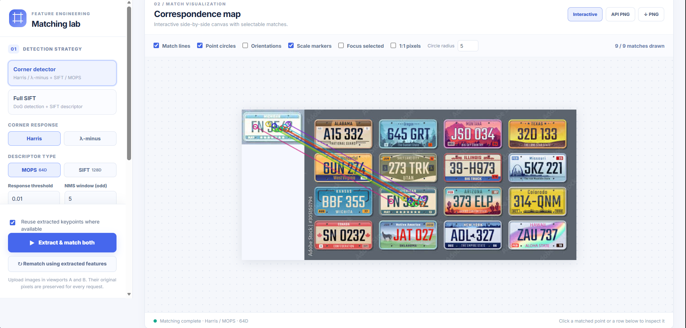
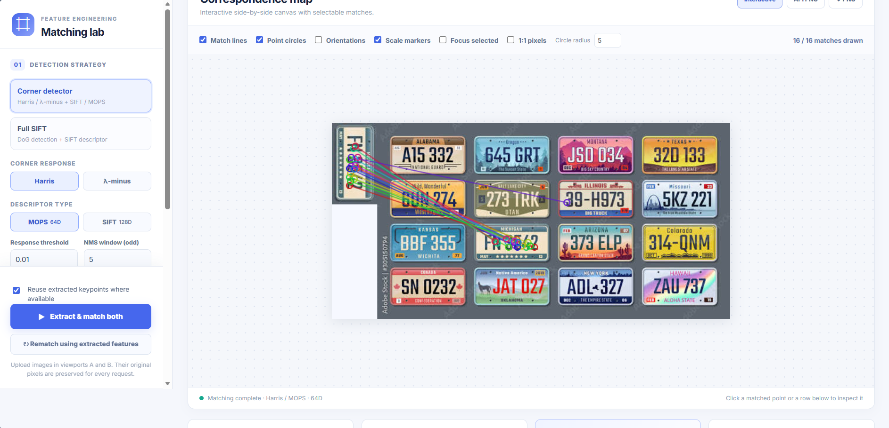

# Computer Vision Task 3: Feature Detection and Matching

An interactive feature-engineering application for detecting image features and matching them across different views. The Angular frontend provides keypoint extraction, descriptor selection, and match visualization, while the Python FastAPI backend implements the computer vision algorithms.

## Features

| Feature | Implementation |
| --- | --- |
| Harris corner detection | Sobel gradients, a 2D structure tensor, and the Harris corner response |
| Lambda-minus corner detection | The smaller eigenvalue of the same structure tensor |
| MOPS descriptors | Aligned, normalized 8 x 8 intensity patches (`64D`) |
| SIFT descriptors | Orientation assignment and a 4 x 4 x 8 gradient histogram (`128D`) |
| Full SIFT detection | Gaussian scale-space, Difference of Gaussians, keypoint localization, orientation, and descriptor extraction |
| Feature matching | SSD or NCC, Lowe-style ratio test, cross-checking, and optional score threshold |

## Visual Results

### Harris Keypoint Detection

Harris corners are shown as circular markers over the input image. Strong local maxima of the Harris response are retained after nonmaximum suppression.


### Harris and MOPS Feature Matching

The two images are displayed side by side. Each retained correspondence is marked in the same color on both images, with an optional connecting line.


### SIFT Keypoint Detection

Full SIFT keypoints are visualized with scale circles and dominant orientation rays. The descriptor calculation produces a `128D` unit vector for each detected orientation.


### SIFT Feature Matching

Matched SIFT descriptors are shown across both input views. Matching can use SSD or NCC and can be refined with a ratio test and mutual nearest-neighbor cross-check.


### Brightness Robustness Test

This test compares feature detection and matching after a brightness change. It demonstrates whether the method remains stable under additive intensity variation.



### Rotation Robustness Test

This test examines keypoint and descriptor behavior after rotation. Oriented descriptors should remain consistent while the feature locations rotate with the image.



## Harris and Lambda-minus Corner Detection

Both corner detectors use the same first-order gradients and structure tensor.

### 1. Grayscale Preparation

- Convert the source image to grayscale.
- Normalize floating-point input to the range `[0, 1]`.

### 2. Sobel Gradients

The horizontal and vertical Sobel kernels are convolved with the image to obtain `gx` and `gy`.

The three structure-tensor terms are then computed:

- `sxx = Gaussian(gx * gx)`
- `syy = Gaussian(gy * gy)`
- `sxy = Gaussian(gx * gy)`

A `5 x 5` Gaussian kernel with sigma `1.4` smooths these terms.

### 3. Corner Response

**Harris response**

```text
R = sxx * syy - sxy^2 - k * (sxx + syy)^2
```

The implementation uses `k = 0.04`.

**Lambda-minus response**

```text
lambda_minus = 0.5 * (sxx + syy - sqrt((sxx - syy)^2 + 4 * sxy^2))
```

Lambda-minus is the smaller eigenvalue of the structure tensor and is a Shi-Tomasi-style corner measure.

### 4. Keypoint Extraction

1. Normalize the threshold relative to the maximum response.
2. Apply a user-defined odd-sized maximum filter for nonmaximum suppression.
3. Remove points near the image border.
4. Sort the remaining points from strongest to weakest.
5. Optionally limit the number of returned keypoints.

## MOPS Descriptor

MOPS (Multi-Scale Oriented Patches) descriptors are used for aligned corner patches.

1. Smooth the grayscale image.
2. Estimate a local orientation from the Sobel gradient at the keypoint.
3. Rotate the patch so its orientation becomes canonical.
4. Scale and warp a `40 x 40` neighborhood to an `8 x 8` patch.
5. Zero the patch mean and divide by its standard deviation.
6. Flatten the result into a `64D` descriptor.

Constant patches with negligible variance are discarded because they cannot provide meaningful normalized information.

## Full SIFT Pipeline

The SIFT implementation follows the standard scale-space-to-descriptor pipeline.

### 1. Scale-Space Generation

- Build multiple octaves from the input image.
- Blur each octave with a sequence of Gaussian filters.
- The default base sigma is `1.6`.
- Incremental blurring creates consecutive scale levels.
- Subsequent octaves are produced by downsampling the appropriate Gaussian level.

### 2. Difference of Gaussians

Each Difference-of-Gaussians image is:

```text
DoG(s) = Gaussian(s + 1) - Gaussian(s)
```

The DoG pyramid emphasizes blobs and corners that appear consistently at a scale.

### 3. Local Extrema Detection

Candidate keypoints are pixels that are:

- Strictly larger than or smaller than all 26 neighbors in a `3 x 3 x 3` scale neighborhood.
- Not placed on the DoG image border.

### 4. Keypoint Localization and Filtering

For each candidate, the implementation:

- Fits a quadratic Taylor approximation to localize the point in image and scale.
- Rejects low-contrast extrema.
- Rejects edge responses using the principal-curvature ratio test.
- Removes unstable points outside the valid image region.

The default contrast threshold is `0.03`, and the default principal-curvature threshold is `10.0`.

### 5. Dominant Orientation Assignment

For each accepted keypoint:

1. Calculate gradient magnitude and direction in `[0, 360)` degrees.
2. Weight gradients with a Gaussian window whose sigma is `1.5 * keypoint sigma`.
3. Fill a `36`-bin orientation histogram.
4. Smooth the histogram.
5. Select local peaks.
6. Use parabolic interpolation to refine peak positions.
7. Accept weaker peaks above `80%` of the dominant peak as additional orientations.

The angular difference helper handles the `0/360` degree wrap-around.

### 6. SIFT Descriptor Calculation

Each oriented keypoint is described through these stages:

1. Extract a local neighborhood at the keypoint scale.
2. Rotate the neighborhood to make the dominant orientation canonical.
3. Normalize local gradient angles relative to that orientation.
4. Apply Gaussian weighting that reduces the influence of pixels away from the center.
5. Divide the neighborhood into a `4 x 4` spatial grid.
6. Build eight orientation bins for every spatial cell.
7. Use trilinear interpolation across row, column, and orientation dimensions.
8. Flatten the grid into `128` values.
9. L2-normalize the descriptor.
10. Clamp values above `0.2`, then normalize again.

## Feature Matching

The matcher compares every descriptor from the first image with every descriptor from the second image.

### Matching Metrics

**Sum of Squared Differences (SSD)**

```text
SSD(a, b) = sum((a - b)^2)
```

Lower SSD indicates greater similarity.

**Normalized Cross-Correlation (NCC)**

Each descriptor is zero-centered before correlation. Higher NCC indicates greater similarity.

### Match Filters

- **Lowe ratio test:** The best distance must be below `ratio * second_best_distance`. The default ratio is `0.75`.
- **Mutual cross-check:** The first image's best match must also be the second image's best match.
- **Optional threshold:** Accept only SSD values at or below the threshold, or NCC values at or above the threshold.
- **Maximum match count:** Optionally return only the strongest matches.

The result includes original keypoint indices, coordinates, raw score, match count, descriptor time, and matching time.

## API

### Corner detection

| Endpoint | Purpose |
| --- | --- |
| `POST /corners` | Detect Harris or lambda-minus corners and return MOPS or SIFT descriptors |
| `POST /corners/overlay` | Return an RGB PNG with circles drawn around corners |

Useful corner parameters include `method`, `descriptor_method`, `threshold`, `window_size`, `margin`, and `max_keypoints`.

### SIFT

| Endpoint | Purpose |
| --- | --- |
| `POST /features/sift` | Return SIFT keypoints and `128D` descriptors |
| `POST /features/sift/visualize` | Return a PNG with scale circles and orientation rays |

Common SIFT parameters include `contrast_threshold`, `edge_threshold`, `num_octaves`, `num_intervals`, `sigma`, `peak_ratio`, and `descriptor_threshold`.

### Matching

| Endpoint | Purpose |
| --- | --- |
| `POST /features/match` | Match uploaded feature sets and return JSON |
| `POST /features/match/visualize` | Return a side-by-side matching visualization |

## Running the Application

### Backend

From the Task 3 directory:

```powershell
cd Backend
python -m uvicorn main:app --reload --host 127.0.0.1 --port 8000
```

The API will be available at `http://127.0.0.1:8000`.

### Frontend

From the Task 3 directory:

```powershell
cd Frontend
npm install
npm start
```

Open `http://127.0.0.1:4200`.

## Technology Stack

| Layer | Technology |
| --- | --- |
| Frontend | Angular 19, TypeScript |
| Backend | Python, FastAPI |
| Feature processing | OpenCV, NumPy, SciPy-based utilities |
| Visualization | OpenCV PNG rendering and Angular canvases |

## Source Images

Additional test inputs are stored in `Sample Images/`. Generated visual demonstrations are stored in `Images/`.
